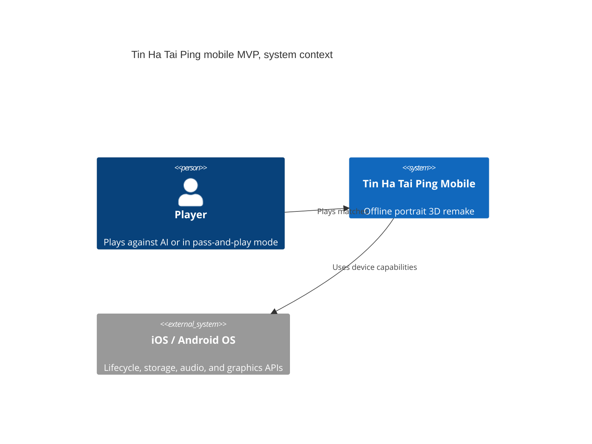
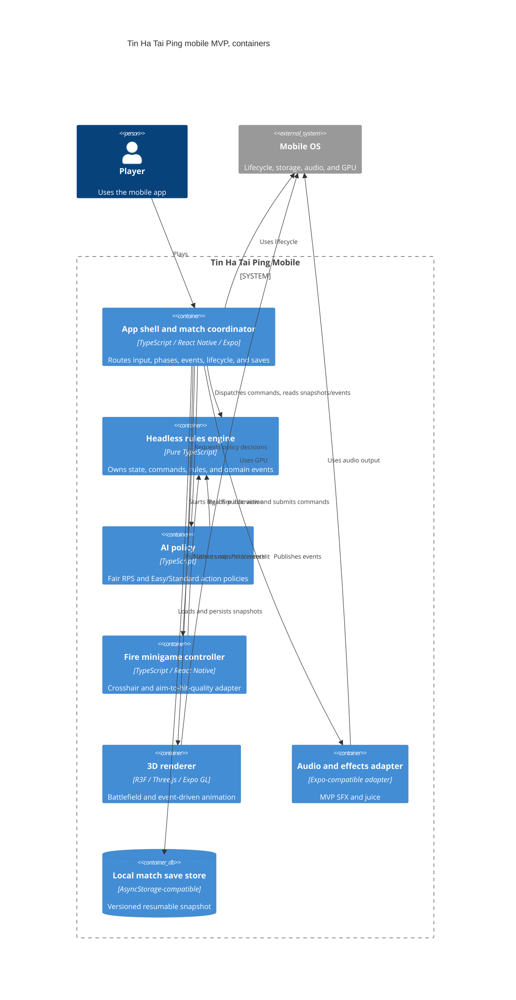
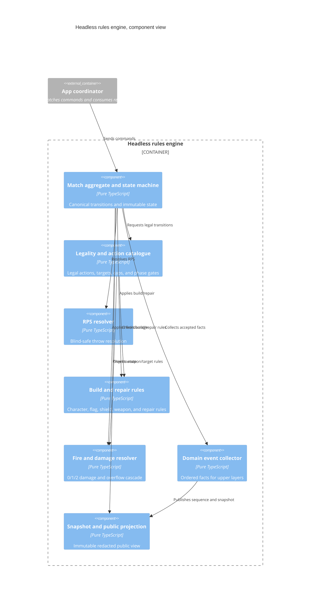
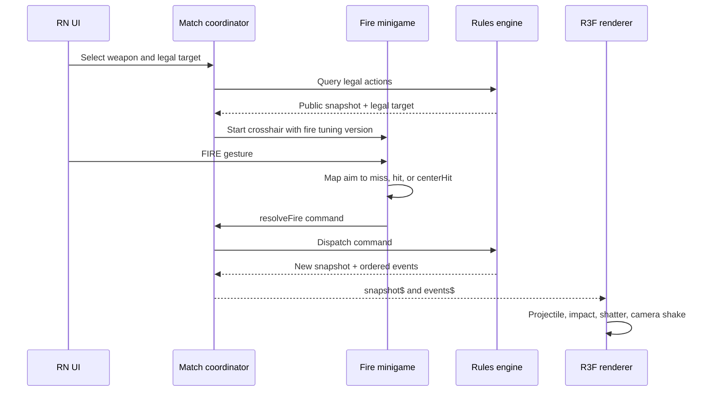
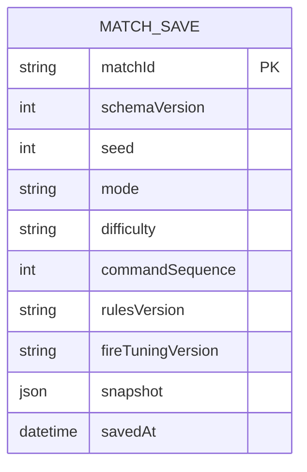

# 0001. Choose Expo React Native with react-three-fiber

Date: 2026-11-23 · Status: accepted

## Context

Tin Ha Tai Ping is a portrait-only, offline iPhone and Android game. The MVP
needs a small 3D battlefield with chunky low-poly fortresses, animated hands,
projectiles, shield destruction, particles, camera shake, and sound. The
success bar is a 5–8 minute match and approximately 60 FPS during the fire and
destruction sequence on mid-range phones. The approved spec also requires one
headless rules-engine seam, no backend, vs AI plus pass-and-play, and exhaustive
engine tests without a device.

The available build bench is strongest in React Native, iOS, and Android, and
the rules engine is explicitly preferred to be TypeScript when a React Native
stack is selected. A hobby-indie project also benefits from one language,
small operational surface, and mobile build tooling that supports quick
iteration.

## Decision

Build the MVP as a TypeScript Expo React Native application using
react-three-fiber, Three.js, and Expo GL for the 3D surface. Keep the rules
engine as a framework-free TypeScript module and connect every upper layer to
it through versioned commands, immutable snapshots, and ordered domain events.

The renderer is isolated behind a `SceneAdapter` boundary. It may be replaced
without changing the engine contract if the performance kill criterion below
is met.

## Stack comparison

| Criterion | Expo React Native + react-three-fiber | Unity |
|---|---|---|
| MVP 3D capability | Sufficient for a bounded low-poly scene, a few animated hands, projectile paths, and a deliberately budgeted particle burst. It uses the same scene graph model for battlefield pieces and effects. | Strongest out-of-the-box 3D renderer, particle system, profiling, and asset workflow. |
| ~60 FPS on mid-range phones | Achievable only with explicit budgets: low-poly meshes, instancing where useful, capped particles, pooled effects, no per-frame React state churn, and release-build device checks. This is the main risk. | Lower technical risk for the 3D target, though art and scene complexity can still cause frame drops. |
| One iOS and Android codebase | One TypeScript application and one native build configuration. React Native, iOS, and Android skills can work in the same seam. | One Unity project also targets both platforms, but it introduces a separate C# and Unity workflow from the team bench. |
| Engine seam | The TypeScript engine is directly importable by the app and test runner. No native bridge is needed. | Requires a C# implementation or a generated/bridged TypeScript contract. The contract can remain language-neutral, but the first implementation would diverge from the bench's preferred language. |
| OTA and build tooling | Expo/EAS gives a familiar mobile build path and a controlled JavaScript update path. Native or renderer changes still require a new binary. | Excellent game builds and platform profiling, but the normal iteration and update path is heavier for a small offline MVP. |
| Long-term hobby maintainability | High for this team: one language, headless tests, standard mobile UI, and a small renderer seam. The team must own R3F performance budgets. | High 3D maintainability if a Unity-focused team is available, but lower fit for the named RN/iOS/Android bench and larger project/tooling footprint. |
| MVP cost and scope fit | Fits the frozen scope without introducing backend or online services. | Risks overbuilding the shell and asset pipeline for the frozen scope. |

Unity is the credible fallback if the bounded R3F scene fails its measured
performance gate. It is not chosen now because the team fit and engine seam
are materially better with TypeScript, while the MVP does not require a large
world, advanced physics, or a high-volume particle simulation.

## System shape

### Runtime boundaries

The deployable is one mobile app. Its internal containers are:

1. **Mobile app shell and match coordinator**: owns navigation, lifecycle,
   input routing, pass-and-play hand-off, event fan-out, and save orchestration.
2. **Headless rules engine**: the only owner of game truth. It has no React,
   Expo, Three.js, device, clock, audio, or random-source dependency.
3. **AI policy**: an adapter above the engine. It receives a public game view
   and legal actions, then returns a command. Its seeded random source is
   injected for tests.
4. **Fire minigame controller**: owns crosshair motion and aim presentation.
   It asks the engine for legal weapons and targets, reads versioned
   weapon/distance tuning, and submits only `miss`, `hit`, or `centerHit`.
5. **3D renderer**: projects an engine snapshot into the battlefield. It never
   mutates game state and never infers legality. Domain events start ephemeral
   animations; the next snapshot remains authoritative.
6. **Audio and effects adapter**: subscribes to the same ordered events and
   maps only the approved MVP events to SFX and juice.
7. **Local match save store**: persists a versioned snapshot. It is not an
   event store, network sync layer, or source of truth while the app is live.

The recommended source layout for the build bench is:

```text
src/
  engine/       # pure rules, contracts, tests
  ai/           # policies and seeded RNG adapter
  app/          # navigation, coordinator, lifecycle, persistence
  fire/         # crosshair controller and fire tuning
  scene/        # R3F scene and event-to-animation adapters
  audio/        # SFX event mapping
  content/      # meshes, textures, audio, and localization
```

### Engine command and result contract

The engine is a synchronous reducer-like module. Each accepted command
produces a new immutable snapshot and an ordered event batch. Rejected commands
produce a typed error and do not mutate state.

```ts
type PlayerId = "player1" | "player2";
type RpsChoice = "rock" | "paper" | "scissors";
type HitQuality = "miss" | "hit" | "centerHit";

type Command =
  | { type: "startMatch"; mode: "vsAi" | "passAndPlay"; difficulty?: "easy" | "standard"; seed: number }
  | { type: "submitRps"; playerId: PlayerId; choice: RpsChoice }
  | { type: "chooseAction"; action: "writeCharacter" | "plantFlag" | "raiseShield" | "deployCannon" | "deployWarplane" | "repair" }
  | { type: "resolveFire"; weaponId: string; targetId: string; quality: HitQuality };

type EngineEvent =
  | { type: "matchStarted"; sequence: number; matchId: string }
  | { type: "rpsResolved"; sequence: number; winner: PlayerId | "draw"; choices: Record<PlayerId, RpsChoice> }
  | { type: "roundWon"; sequence: number; playerId: PlayerId }
  | { type: "pieceBuilt"; sequence: number; playerId: PlayerId; pieceId: string; kind: string }
  | { type: "fireStarted"; sequence: number; attacker: PlayerId; weaponId: string; targetId: string }
  | { type: "shotResolved"; sequence: number; quality: HitQuality; damage: 0 | 1 | 2 }
  | { type: "pieceDamaged"; sequence: number; pieceId: string; damage: number }
  | { type: "pieceDestroyed"; sequence: number; pieceId: string; kind: string }
  | { type: "repairCompleted"; sequence: number; pieceId: string }
  | { type: "matchOver"; sequence: number; winner: PlayerId; loser: PlayerId };

type EngineResult = {
  snapshot: PublicGameSnapshot;
  events: readonly EngineEvent[];
  error?: { code: string; message: string };
};
```

The production contract should use discriminated unions and schema tests, not
stringly typed payloads. `sequence` is a logical monotonic number, not wall
clock time. `submitRps` is accepted without returning the selected choice to
the public snapshot or to a pre-reveal event. In pass-and-play, both choices
are revealed only in `rpsResolved` after the second selection arrives. The
same redaction applies to debug projections used by the UI.

The engine owns these rules:

- round and phase transitions;
- build order and caps of 4 characters, 3 flags, 5 shields, and 3 weapons;
- legal target selection;
- `miss = 0`, `hit = 1`, and `centerHit = 2`;
- overflow cascade: outermost shields, nearest weapon, flags, then
  characters in `平 → 太 → 下 → 天` order;
- repair ordering and the match-over condition;
- the fact that no further command is accepted after `matchOver`.

The engine does not own crosshair pixels, animation timing, sound, particles,
AI heuristics, or device input.

### Event-driven animation subscription

The coordinator is the only object allowed to dispatch commands. It publishes
the accepted result as two streams:

- `snapshot$`: latest immutable public snapshot, used to render persistent
  state;
- `events$`: ordered, one-shot facts, used to start ephemeral animation,
  audio, haptics, and screen transitions.

The 3D scene reconciles all durable pieces from `snapshot$`. It listens for
`rpsResolved` to animate hands, `fireStarted` to launch a projectile,
`pieceDamaged` and `pieceDestroyed` to play impact and shatter effects, and
`matchOver` to finish the scene. Audio consumes the same events but has no
write path to the engine. Event consumers track the last sequence they have
handled. If the app backgrounds or reloads, pending effects are discarded and
the restored snapshot is rendered, avoiding duplicate destruction or sound.

### Fire minigame seam

The fire controller starts only after the engine exposes a legal
`fire(weaponId, targetId)` action. It selects a versioned tuning profile from
the weapon type and normalized distance. The tuning data contains crosshair
speed, bullseye radius curve, center radius curve, and close/long-range
weapon weighting. It lives in `src/fire/tuning/`, is reviewed as data, and
is not embedded in renderer components.

On the FIRE gesture, the controller evaluates the crosshair position against
the tuning profile and emits exactly one `resolveFire` command with a
`HitQuality`. The engine independently validates the weapon and target, then
resolves damage and cascade. The controller does not calculate HP or choose a
fallback target. A miss still consumes the shot and advances the round.

Gameplay constants that affect rule legality, such as caps, HP, repair order,
and cascade order, live in the engine's versioned rules configuration. The
two configuration sets must not be mixed: fire tuning controls aim feel;
engine rules control truth.

### Persistence and lifecycle

Live state is owned by the in-memory engine instance. After every accepted
command, the coordinator debounces a write and also writes on app background:

```text
tin-ha-tai-ping.match.v1 = {
  schemaVersion,
  matchId,
  seed,
  mode,
  difficulty,
  commandSequence,
  rulesVersion,
  fireTuningVersion,
  snapshot,
  savedAt
}
```

The local store contains at most the current resumable match and small
settings. It has no sensitive user data, no account identity, and no conflict
resolution. A schema migration either produces a valid newer snapshot or
discards the stale match and starts a fresh one. There is no cross-device
backup or network sync in the MVP. A rematch explicitly creates a new engine
instance and clears the old match.

### C4 diagrams

The formal C4 source of truth is
[`docs/architecture/workspace.dsl`](../architecture/workspace.dsl). The
following Mermaid views are quick diagrams that make the boundary reviewable
in Markdown; the Structurizr exports are the rendered artifacts.

#### Context



#### Containers



#### Engine components



#### Command and event sequence



#### Persistence model



## Non-functional requirements checklist

Every item from `references/nfr-checklist.md` is accounted for:

| NFR item | Status | Architectural treatment |
|---|---|---|
| Target device floor | ✅ | Performance floor is iPhone 11/A13-class and Pixel 6a-class or equivalent, 60 Hz, 4 GB+ RAM. Distribution minimum remains a fs-pm decision before build. |
| Startup and latency budget | ✅ | Release build must reach an interactive start/match screen within 3 seconds on the floor device. Fire command resolution is synchronous and animation is not allowed to block state commit. |
| Data volume | ✅ | One local save is at most 256 KB by design. Assets are bundled and capped by the performance budget. There is no CDN or backend data store. |
| Offline behavior | ✅ | All MVP flows work offline. There is no sync and no conflict owner beyond the device-local engine snapshot. |
| Scale model | ✅ | Single-user-per-device by design, with two local players sharing the same device. |
| First 10x break | ✅ | Runtime rules do not scale with users. The first likely 10x issue is app bundle and asset distribution size, handled by asset budgets and release profiling. |
| Read/write ratio | ✅ | Game reads are in-memory per frame. Local persistence writes only after accepted commands, on a debounce, and on background. No cache service is needed. |
| Auth and sessions | ✅ | No accounts, authentication, or sessions in the MVP. |
| Data at rest | ✅ | Only non-sensitive match state and settings are stored locally. No custom encryption is required for the frozen scope. |
| Transport | ✅ | Runtime is offline and makes no network calls. Store, build, and OTA tooling must use HTTPS. |
| Secrets | ✅ | No secrets in the app or repository. Signing credentials and any EAS credentials belong to fs-devops. |
| Third-party data flow | ✅ | Expo, React Native, R3F, Three.js, and local storage receive no gameplay telemetry. Any future crash SaaS requires a new privacy review and ADR amendment. |
| Store privacy manifests | ⚠️ | Required before public store submission. fs-devops must complete Apple privacy manifest and Android Data Safety answers from the final dependency graph. |
| State ownership | ✅ | The in-memory headless engine owns live state; the local snapshot is only a resume input. No distributed conflicts exist. |
| Backup and restore | ✅ | Resume from the local versioned snapshot. Cross-device restore and cloud sync are explicitly not provided. Stale saves are safely discarded. |
| Release and rollback | ⚠️ | fs-devops must choose the TestFlight/internal track or public release path and document binary rollback. OTA is allowed only for JS-compatible changes and must be disabled until that process exists. |
| Minimum OS versions | ⚠️ | Proposed: iOS 15+ and Android API 26+. fs-pm must confirm the floor against the selected Expo SDK and store plan before implementation begins. |
| Foldable and tablet layout | ✅ | Deferred for MVP, which is portrait phone only. No tablet optimization work may enter the frozen scope. |
| Store policy risks | ✅ | No sign-in, IAP, ads, online play, or personal data collection. fs-devops still owns final store-policy review. |
| Crash and error reporting | ✅ | MVP channel is Xcode/Android log capture plus TestFlight/Play internal crash consoles, with no runtime telemetry. A public release may add a reviewed crash service later. |
| Log discipline | ✅ | Release logs contain no player identifiers, choices before reveal, tokens, or device secrets. Debug logging is disabled in release builds. |
| Local debugging | ✅ | Argent runs iOS and Android flows, engine tests run headlessly, and the renderer exposes a release-like FPS overlay for the fire spot check. |
| One-command build/test | ⚠️ | The dev bench must provide `pnpm test:engine`, `pnpm test`, and one documented iOS/Android release-build smoke command before tickets are dispatched. |
| Layout conventions | ✅ | The proposed `src/` layout and seam are documented here. fs-rn-dev must add/update repo-local conventions before implementation. |
| Dependency policy | ✅ | fs-lead approves new runtime dependencies. Engine dependencies remain zero-framework and every container has an owning specialist. |
| Monthly run-cost ceiling | ✅ | Runtime ceiling is $0/month for the MVP. Store/developer account fees and optional build-service fees are release decisions, not runtime architecture. |
| Accepted cost line | ⚠️ | fs-pm must record whether TestFlight/internal distribution or public store fees are accepted before ship. |

Deferred items are release or bench prerequisites, not permission to expand the
MVP scope.

## Risks and mitigations

| Risk | Impact | Mitigation and acceptance evidence |
|---|---|---|
| R3F and Expo GL frame drops during destruction | High | Keep renderer isolated; use low-poly meshes, pooled projectiles, capped particle counts, instancing where measured useful, no React state updates per frame, and release-build profiling. Story 17 is not accepted until the target device spot check passes. |
| Expo GL or native module incompatibility | High | Pin the Expo SDK and native dependencies as one approved set. Run iOS and Android release builds early, not only a web or simulator preview. If the selected Expo SDK cannot provide the required GL path, stop and revisit the stack before scene work. |
| Particle memory spikes and thermal throttling | High | Pool and recycle effects, cap simultaneous particles, avoid unbounded trail buffers, run a 10-second repeated fire sequence, and record memory/FPS on floor devices. |
| Renderer state diverges from rules state | High | Renderer consumes snapshots for durable state and events only for effects. No local legality or HP logic. Add a debug snapshot replay harness and assert that scene piece IDs match the snapshot. |
| Pass-and-play choice leakage | High | Redact pending choices in public snapshots and events, clear the previous player's UI before hand-off, and test on a physical device with the second player observing. |
| Fire minigame bypasses engine legality | Medium | Engine revalidates weapon, target, phase, and ownership on every `resolveFire`. The fire controller submits only hit quality, never damage or cascade targets. |
| Tunables create a non-reproducible balance problem | Medium | Version fire tuning, inject the version into saves and test fixtures, keep rule constants separate, and seed engine/AI tests. |
| R3F ecosystem or team bus factor grows | Medium | Keep a narrow `SceneAdapter`, document the event contract, and avoid renderer-specific types in the engine. The Unity fallback remains viable at that boundary. |
| Audio implementation violates mute or store expectations | Low | Use platform-respecting audio APIs, no music, short SFX only, and verify the device mute switch in QA. |
| Local save corruption | Low | Write a single versioned envelope, validate on load, discard invalid data safely, and always allow a new match. No cloud recovery is promised. |

## Kill criterion

Supersede this ADR and reassess Unity before accepting story 17 if a release
build cannot sustain at least 55 FPS for the complete 10-second fire and
shatter sequence on both the iPhone 11/A13-class and Pixel 6a-class floor
devices after two documented optimization passes, or if peak memory exceeds
250 MB during that sequence. The reassessment must preserve the command,
snapshot, event, and save contracts, and must be recorded as a new ADR rather
than silently changing the renderer.

## Sign-off

- [x] All NFR checklist musts are addressed or explicitly deferred in the table
  above.
- [x] C4 context, container, and engine component diagrams are present in the
  ADR, with formal Structurizr source in `docs/architecture/workspace.dsl`.
- [x] The stack decision has rationale, alternatives, consequences, and a kill
  criterion.
- [x] The headless engine seam, event contract, fire input, persistence, and
  tunable ownership are defined.
- [x] Rendered C4 artifacts are supplied beside the formal model for fs-pm to
  review before dispatch.
- Verdict: **APPROVED TO BUILD**: risks accepted: R3F/Expo GL performance and
  device-specific renderer compatibility, subject to the conditions below.

### Conditions for the dev bench

1. fs-pm confirms the distribution minimum OS versions and records the
   TestFlight/internal versus public release decision.
2. fs-lead pins the Expo/R3F/Three/native dependency set and owns the
   performance spike. No renderer-heavy ticket is considered unblocked until
   release builds run on both floor devices.
3. fs-rn-dev implements the engine contract as the only gameplay authority.
   UI, AI, fire, renderer, and audio must not duplicate rule decisions.
4. The bench supplies the one-command engine and app test/build commands,
   seeded deterministic fixtures, and the public-snapshot redaction tests
   before device QA.
5. fs-qa records FPS, memory, mute-switch behavior, full-match smoke results,
   and pass-and-play privacy results. Any kill-criterion failure returns to
   architecture for a new ADR.

ARCHITECT SIGN-OFF: APPROVED
